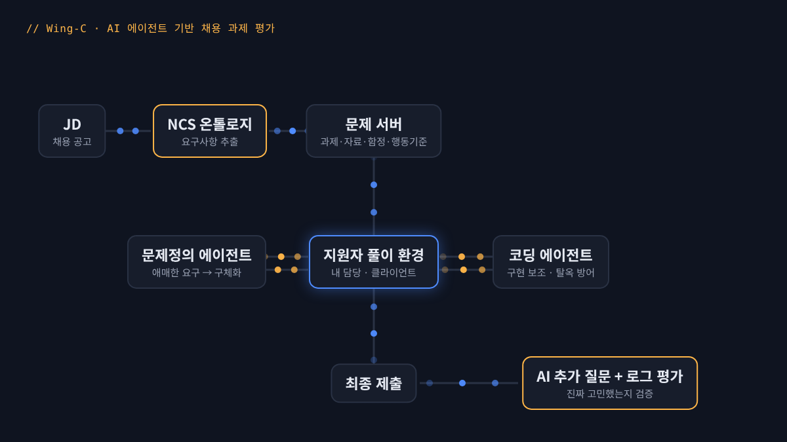
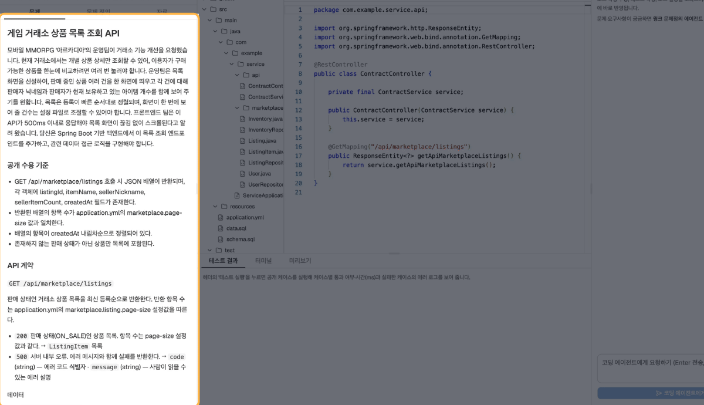

요즘 회사에서 개발할 때 AI에 맡기는 비중이 눈에 띄게 늘었습니다. 그러다 보니 자연스럽게 고민도 생겼습니다. 앞으로 개발자는 어떤 역량을 키우며 성장해야 할까요? 그리고 회사는 지원자의 어떤 역량을 검증해야 할까요?

막연한 고민과 걱정만 쌓여 가던 차에, 스마일게이트 개발자 커뮤니티 MODAC의 모닥랩 5기에서 AI 시대 개발자 채용 검증 도구 만들기라는 주제가 열렸습니다. 지난 상반기 [모닥글 스터디](/blog/modac-lab-2026/)를 호스트했던 것에 이어, 이번에는 참여자로 5주 동안 팀원들과 함께 MVP를 만들었습니다.

짧지만 강렬했던 이 스터디를 돌아보며, 요즘 스타트업과 기업의 채용 현황을 보며 들었던 생각을 정리해 보겠습니다.

## 어떤 스터디였나요?

이번 주제는 MODAC 운영진이자 스마일게이트 인재영입팀이 직접 호스트를 맡았습니다. 채용 현장에 있는 분들이 개발자들과 함께 채용 과정의 문제를 풀어 보자는 취지였고, 스터디 소개 글은 이렇게 시작합니다.

> AI를 활용한 개발이 일상화되며 채용 과정에서 보여주고 확인해야 할 경험과 역량도 달라지고 있습니다. 지원자는 자신의 문제 해결 방식과 강점을 보여주고 싶고, 기업은 지원자의 역량과 가능성을 더 깊이 이해하고자 합니다.

참여 멤버들은 각자의 직무 경험을 바탕으로 지원자와 기업 모두에게 도움이 될 도구 아이디어를 내고, 서비스 콘셉트와 사용자 흐름을 설계한 뒤 목업이나 MVP까지 직접 구현합니다. 5주 동안의 계획은 다음과 같았습니다.

| 주차 | 주제                             | 내용                                                                                     |
| ---- | -------------------------------- | ---------------------------------------------------------------------------------------- |
| 1주  | 채용 경험과 문제 탐색            | 지원자와 기업이 채용 과정에서 겪는 어려움을 살펴보고, 집중할 직무와 핵심 문제를 정합니다 |
| 2주  | 사례 탐색과 아이디어 구체화      | 관련 서비스와 사례를 참고해 도구 아이디어와 핵심 가치를 구체화합니다                     |
| 3주  | 서비스 콘셉트와 사용자 경험 설계 | 지원자와 기업 관점에서 사용자 흐름을 설계하고 MVP 범위를 정합니다                        |
| 4주  | 목업과 MVP 구현                  | 핵심 가치를 보여 줄 목업이나 MVP를 구현하고 흐름을 다듬습니다                            |
| 5주  | 데모와 결과 정리                 | 결과물을 공유하고 피드백을 나누며 후속 발전 방향을 정리합니다                            |

## 시작하며 세운 목표

제가 이 스터디에서 가장 알고 싶었던 것은 기업의 채용 담당자들이 어떤 생각과 기준으로 지원자를 검증하는가였습니다.

지금까지는 늘 지원자 입장으로 취업을 준비하면서 어떻게 하면 채용 담당자가 읽기 좋은 이력서를 쓸 수 있을지, 그래서 면접까지 갈 수 있을지만 고민해 왔습니다. 반대편에 앉은 사람의 시선을 들을 기회는 거의 없었기 때문에, 채용 담당자분께서 직접 호스트를 맡은 이 스터디가 새로운 관점을 얻기에 제격이라고 생각했습니다.

## 스터디에서 한 것

### AI가 이력서를 다듬어 주는 시대의 채용

초반 주차에는 기업 사례를 조사하면서, 요즘 기업들이 어떤 기준으로 사람을 뽑는지, 지원자와 기업이 서로에게 어떤 불편을 느끼는지 이야기를 나눴습니다.

가장 놀라웠던 것은 이력서의 품질이 전반적으로 너무 좋아졌다는 이야기였습니다. AI가 글을 다듬어 주다 보니 대부분의 이력서가 일정 수준 이상으로 잘 쓰여 있고, 그만큼 누가 더 효과적으로 썼는지, 누구의 이력이 더 믿을 만한지 가려내기가 매우 어려워졌다고 합니다.

그렇다면 기업은 검증 방식을 크게 바꾸고 있을까요? 오히려 반대였습니다. AI가 워낙 빠르게 발전하다 보니 새로운 검증 방식을 도입해도 금방 의미가 없어질 수 있다는 불확실성이 있고, 그래서인지 여전히 코딩 테스트 같은 전통적인 방법으로 지원자를 검증하고 있었습니다.

### 코드를 쓰는 시간이 무의미해진다면

저희 팀은 여기서 한 걸음 더 나아가 가정을 세웠습니다. AI가 지금보다 훨씬 발전해서 코딩 테스트도, 직접 코드를 작성하는 시간 자체도 의미가 없어진다면, 그때는 지원자의 무엇을 검증해야 할까요? 이 가정을 출발점으로 MVP를 만들기 시작했습니다.

저희는 크게 두가지로 나뉘어서 개발을 시작했는데요. 우선 첫쨰로, 문제를 만드는 서버를 제작하였습니다. 채용 공고의 직무 기술서에서 요구 사항을 뽑아내고, 이를 국가직무능력표준인 NCS 기준으로 온톨로지화한 뒤, AI로 과제와 참고 자료, 함정, 행동 기준을 생성하도록 하였습니다. 다른 하나는 지원자가 AI 에이전트를 활용해 그 문제를 푸는 서비스를 만들었습니다.

해당 서비스 특징은 지원자는 먼저 문제 정의 에이전트와 대화하며 애매하게 주어진 문제를 구체적으로 정의를 해야하고, 구현은 별도로 개발한 코딩 에이전트와 함께 진행해야 한다는 점입니다. 최종 제출 후에는 AI가 생성한 질문으로 지원자가 정말 문제를 고민하며 풀었는지 한 번 더 확인하고, 지원자가 에이전트를 사용한 로그를 바탕으로 평가하도록 하였습니다.

채용 공고에서 문제 생성, 풀이, 평가까지 이어지는 전체 흐름

### 탈옥은 막고, 도움은 되는 에이전트

저는 이 중에서 지원자가 문제를 푸는 클라이언트를 맡았습니다. 가장 오래 고민한 것은 두 가지였습니다. 지원자가 에이전트를 탈옥시켜 답을 얻어 내는 것을 어떻게 막을지, 그리고 지원자가 애매한 문제를 앞에 두고 현업에서 동료에게 물어보듯 자연스럽게 문제를 정의해 나가게 하려면 어떻게 해야 할지였습니다.

지원자 풀이 환경에서 문제를 읽고 제출하기까지의 과정

직접 구현해 보니 에이전트를 탈옥시킬 방법은 생각보다 훨씬 많았습니다. 그렇다고 제어를 조금만 강하게 걸면 에이전트가 너무 멍청해져서 도움이 되지 않았고, 조금 풀어 주면 이번에는 너무 똑똑해져서 문제를 다 풀어 버렸습니다. 이 사이의 균형점을 찾는 일이 가장 어려웠습니다.

## 다른 사람들에게서 배운 것

팀원분들과 문제를 어떻게 생성할지 이야기할 때, NCS 기준으로 역량을 정량화하고 그 기준에 맞춰 문제를 만들자는 의견이 특히 인상 깊었습니다.

저는 AI로 문제를 생성하면 지원자마다 난이도가 달라져 공정성이 흔들리지 않을까 걱정하고 있었습니다. 크래프톤에서 만들었었던 코파 프로브라는 서비스도 말이 많았었다보니 걱정이 들었었는데, 사람마다 다른 암묵적인 판단 대신 NCS라는 공통 기준에 맡기니, 생성되는 문제가 어느 정도 균형을 유지한다는 점이 무척 흥미로웠습니다.

루브릭으로 지원자를 정량적으로 채점한다는 아이디어도 인상 깊었습니다. 지원자가 AI와 함께 개발하고 그 대화 내용과 기록으로 역량을 파악하는 구조이다 보니, 과연 일관된 기준으로 점수를 매길 수 있을지 막연히 궁금했는데 루브릭이 그 답이 되어 주었습니다.

## 스터디를 마치며

직장인들이 모인 스터디에서 이런 고민이 오가고, 5주 만에 MVP라는 결과물까지 나오는 것을 보면서, 지금처럼 AI가 발전한다면 머지않아 개발자를 평가하는 역량 지표 자체가 크게 바뀔 수도 있겠다는 생각이 들었습니다.

그러면서도 그 안에서 경쟁력을 갖추려면 결국 기본이 중요하다고 느꼈습니다. 코딩 테스트 같은 기본기를 꾸준히 다지고, 부족하더라도 하나의 문제를 계속 깊게 고민할 줄 아는 사람이 되어야겠다고 다짐하며 이번 회고를 마칩니다.
