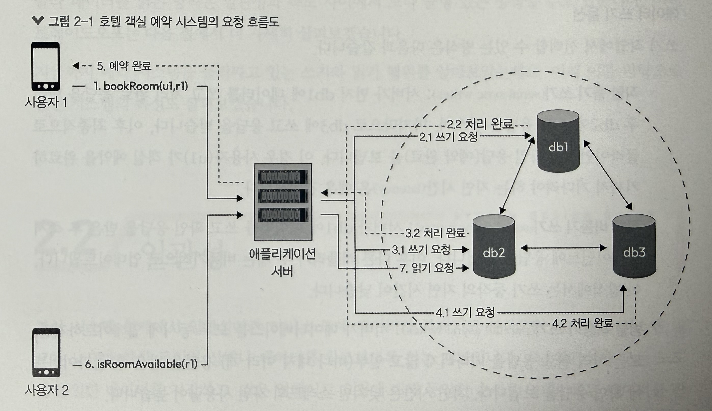
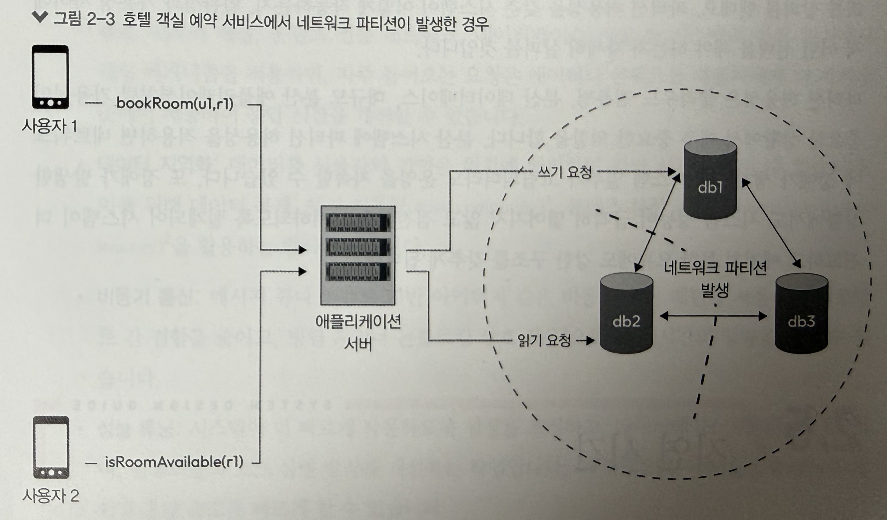

## 호텔 객실 예약 시스템으로 알아보는 분산시스템 예시

만약 한사용자가 호텔방을 예약할때 다른 사용자는 같은 방의 예약 가능 여부를 확인하려고 하면 어떻게 작동할까?

#### 쓰기 작업
- 사용자(u1)가 방을 예약(r1)할 때 RoomAvailable API 이용해서 앱서버 (u1,r1) 요청 보냄.
- 해당 서버는 여러 레플리카에 데이터 기록
    - **직렬 동기 쓰기** : 이때 db1에 먼저 데이터 쓰고 db2 → db3 이런식으로 쓴다음 응답을 받음.
    - **직렬 비동기 쓰기** : db1에 데이터 쓴다음 즉시 클라이언트 응답보내고 비동기로 db2,db3에 저장
    - **병렬 비동기 쓰기** :  서버가 데이터베이스에 모두 동시 업데이트 하지만 처리완료 응답 기다리지않고 일부 응답 받은 다음에 확인 응답 보냄. 스레드 자원 사용량 높음.
    - **카프카 쓰기**: 메시징 서비스에 데이터 기록 후 바로 응답 보냄. 이후 consumer쪽에서 데이터 읽을때 메시징 서비스에서 읽어옴.

#### 읽기 작업
- 사용자(u2)가 방(r1)의 예약 가능 여부를 파악할때, RoomAvailable API 이용해서 (u2,r1) 예약 가능 여부 요청함. 이때 서버는 여러 레플리카에 데이터 조회함.
    - **하나 레플리카에서만 읽기** : 하나의 레플리카만 데이터베이스 가지고와서 읽기
    - **일부 레플리카에서만 읽기** : 과반수 해당하는 렢플리카에서 데이터 읽어와서 일관성 확인 후 클라에 반영
    - **모든 레플리카 읽기** : 모든 레플리카 데이터 읽은 후 클라이언트 반환

> **왜 여러 서버 레플리카 쪽에 데이터를 기록하고 저장할까?**
> - db1이 죽더라도 나머지 db2,db3쪽에서 운영할 수 있음.
> - 예약 시스템은 조회가 예약보다 훨씬 더 많기 때문에 읽기를 여러 레플리카로 분산하면 부하가 나뉨.
> - 레플리카를 지역별로 두면 사용자는 가까운 DB를 읽을수도 있음.

이때 분산시스템내에서 신경써야할 것들이 9가지가 있음.
- 일관성
- 가용성
- 파티션 허용성
- 지연 시간
- 내구성
- 신뢰성
- 장애 허용성
- 확장성

## 일관성

일관성이란 여러 노드에 데이터가 복제되고 분산되어 있더라도 시스템 내 모든 노드가 항상 동일한 상태나 데이터를 참조하도록 하는 개념.

분산 시스템에서 주로 사용하는 유형은 2가지로 나뉨.
- 강한 일관성 (strong consistency)
- 최종 일관성 (eventual consistency)

### 강한 일관성

시스템 내 모든 노드가 공유하고 있는 데이터 업데이트를 동일한 순서로 처리하도록 보장하는 특성. 즉 쓰기 작업 수행된 이후, 모든 읽기 작업은 최신값을 반환해야함.

이때 분산 시스템에서는 강한 일관성 유지하기 위해서 여러 노드가 동시에 작업을 처리할 때 서로 데이터의 업데이트 순서를 맞추는 방법을 사용함. (ex. 분산 트랜잭션, 분산 잠금방식, 팩소스, 래프트)

> **분산 트랜잭션이란?**
>
> 여러 노드(DB)에 걸친 작업을 "전부 성공 or 전부 실패"로 묶는 것.
> 대표 방식: 2PC (2단계 커밋)
> 1. 준비 단계: 코디네이터가 모든 노드에 "커밋할 수 있어?" 물어봄 → 각 노드는 준비 후 Yes/No 응답
> 2. 커밋 단계: 전원 Yes면 "커밋해", 하나라도 No면 "롤백해"
> - ex. db1~db3 모두에 r1 예약을 쓰는데, db3가 실패하면 db1·db2도 롤백 → 사본 불일치 방지
> - 단점: 느림, 코디네이터가 죽으면 노드들이 준비 상태로 묶여 대기 (블로킹)

> **분산 잠금이란?**
>
> 여러 서버가 같은 자원을 동시에 건드리지 못하게, 공유된 잠금을 먼저 획득한 쪽만 작업하게 하는 것.
> - ex. 서버A·서버B가 동시에 r1 예약 요청 → 먼저 r1 락을 잡은 서버만 예약 진행, 나머지는 대기/실패
> - 구현: Redis(Redlock), ZooKeeper, etcd 등
> - 주의: 락을 잡은 서버가 죽을 때를 대비해 만료 시간(TTL)이 필요하고, 이 때문에 생기는 엣지케이스가 까다로움

> **팩소스 (Paxos)**
>
> 노드 일부가 죽거나 메시지가 늦어도, 과반수 동의로 "하나의 값"에 합의하는 합의(consensus) 알고리즘.
> - 제안자가 값을 제안 → 과반수가 수락하면 그 값으로 확정
> - 과반수만 살아 있으면 동작 (3대 중 1대 장애 OK)
> - 단점: 이론적으로 정확하지만 이해·구현이 어렵기로 악명 높음

> **래프트 (Raft)**
>
> 팩소스와 같은 목적(과반수 합의)이지만, 이해하기 쉽게 설계된 합의 알고리즘.
> 1. 리더 선출: 노드들이 투표로 리더 1명 선출
> 2. 로그 복제: 모든 쓰기는 리더가 받아서 팔로워들에게 복제 → 과반수가 저장하면 커밋
> 3. 리더가 죽으면 다시 선출
> - 쓰기 순서를 리더 한 명이 정하므로 모든 노드가 같은 순서로 업데이트를 적용함
> - 사용처: etcd(쿠버네티스), Consul, CockroachDB 등

강한 일관성은 모든 노드가 동일한 순서에 따라 데이터 업데이트하도록 보장하기 때문에 시스템 예측가능하고, 직관적인 방식으로 동작함

**But, 처리 속도가 느리거나 시스템 가용성이 떨어짐**. 그래서 민감한 데이터 다루는 서비스에 사용하기 좋음. 

### 최종 일관성

시스템내에서 데이터 불일치를 허용하지만, 시간이 지나면 모든 레플리카 데이터베이스나 노드가 결국 동일한 상태에 도달하도록 보장하는 방식.

네트워크 지연, 메시지 전달 속도, 레플리카 동기화 같은 문제때문에 일시적인 데이터 불일치 문제가 생길수도 있음.

이를 해결하기 위한 방법들:
- **충돌해결(conflict resolution)** : 노드간 데이터 일관된 상태에 도달하도록 하는 방식
- **데이터 복제(replication)** : 데이터를 여러 노드에 복사하여 유지하는 방식. 하나의 노드가 업데이트되면 다른 레플리카 쪽에 비동기로 전달됨.
- **가십 프로토콜(gossip protocol)** : 시스템 전체에 업데이트가 서서히 전파될 수 있도록 하는 방식

#### 강한 일관성에 비해 안좋은거 아닌가요?
- 가용성과 확장성을 높이고, 클라이언트에 더 빠른 응답시간을 줄 수 있음.
- 그러나 일시적인 데이터 불일치나 충돌을 처리해야하는 과제가 있기 때문에 reconciliation algorithm을 거쳐 최종적으로 일관된 상태를 유지하도록 함.

해당 부분을 다시 돌아와서 

- n: 레플리카 총 개수
- r: 데이터를 읽을 때 참조할 레플리카 수
- w: 데이터를 쓸 때 반영할 레플리카 수 

해당 개수들에 따라 강한 일관성과 최종일관성을 서로 적용하면 됨.

| 설정 (n=3) | r + w | 일관성 | 쓰기 속도 | 읽기 속도 |
| --- | --- | --- | --- | --- |
| w=1, r=3 | 4 | 강한 일관성 | 빠름 | 느림 |
| w=3, r=1 | 4 | 강한 일관성 | 느림 | 빠름 |
| w=2, r=2 | 4 | 강한 일관성 | 보통 | 보통 |
| w=1, r=1 | 2 | 최종 일관성 | 빠름 | 빠름 |

> 항상 r+w > n을 만족할 때 강한 일관성이 보장되며, 그렇지 않을 때는최종 일관성이 적용됨.

## 가용성

시스템에서 장애나 오류가 발생하더라도 사용자에게 서비스를 지속적으로 제공할 수 있는 능력. 즉 서비스 내부에서 발생하는 문제와 상관없이 사용자에게 서비스를 제공할 수 있은 시스템.

가용성을 보장하는 방식에는 여러가지 방식이 있음.
- **다중화** : 시스템 일부 구성 요소에 장애가 발생해도 시스템이 계속 작동할 수 있도록 여러 구성요소나 자원을 중복 해두는 방식. (ex. 전원 공급장치를 여러개 준비해둬서 고장나더라도 나머지를 동작시킴.)
- **복제** : 데이터를 여러 노드에 복제 해놓는 방식.
- **로드밸런싱**
- **장애 감지 및 복구** : 모니터링 및 헬스 체크
- **장애 전환 및 복귀** : 문제가 발생한 노드일경우 백업 노드나 다른 노드로 돌리는 방식

## 파티션(네트워크 파티션) 허용성

### 네트워크 파티션
분산시스템내에서 네트워크 파티션이란 일부 노드나 컴포넌트가 시스템과의 연결이 끊겨 서로 접근하거나 데이터 주고받지 못하는 상태를 의미함.

네트워크 파티션 경우 네트워크 장애, 하드웨어 고장, 시스템 버그로 인해 발생할 수 있음.

그래서 분산시스템내에 노드간 통신과 조율을 방해해서 시스템 운영내에 어려움이 존재함.

### 파티션 허용성

해당 위의 문제를 파티션 허용성을 통해 정상적으로 작동하게 할 수 있음.

아까 재고 예시에서 DB1은 마지막 상품이 팔려서 0개, **DB2는 아직 1개**라고 가정해보자. 두 DB 사이의 네트워크가 끊기면 DB2는 재고가 바뀌었는지 확인할 수 없음. 이때 B의 조회 요청이 DB2 쪽으로 들어오면 두 가지 선택이 있음.

| 우선하는 것 | DB2 쪽에서 들어온 재고 조회 |
| --- | --- |
| **일관성(C)** | 최신 재고를 확인할 수 없으니 요청을 거절하거나 연결이 복구될 때까지 기다려요. |
| **가용성(A)** | 지금 가진 값인 `1개`를 응답해요. 그래서 화면에는 잠깐 구매 가능으로 보일 수 있어요. |

## 지연 시간

지연 시간이란 분산 시스템에서 들어온 요청에 대한 응답이 돌아오기까지 걸리는 시간. (분산 시스템내 중요한 지표)

지연 시간은 아래의 경우대로 영향받을 수 있음.
- 시스템 내 노드 간 거리
- 네트워크 혼잡도
- 각 노드에서 처리 시간
- 전송되는 데이터의 크기와 복잡성

이를 해결하기 위해서는 아래 해결방법을 고려할 필요가 있음.
- **네트워크 최적화** : 네트워크 인프라 개선하는 방법. 홉수 줄이기, 네트워크 혼잡도 줄이기
- **캐싱** : 메모리 캐싱, CDN, 데이터베이스 캐싱
- **데이터 지역화** : 데이터를 사용자와 가까운 위치에 배치
- **비동기 통신** : 메시지 큐나 이벤트 기반 아키텍처
- **성능 튜닝**: 데이터베이스 쿼리 최적화라던가, 알고리즘 코드 실행 방식 개선하는 작업

>**네트워크 홉이란?**
>
> 출발지에서 보낸 패킷이 최종 목적지까지 가는 동안 라우터 같은 네트워크 장비 거쳐서 다음 구간으로 이동하는 과정

## 확장성

분산시스템에서 확장성이란 사용자 수나 데이터 양이 증가해도 성능이나 신뢰성을 유지하면서 시스템이 더 많은 작업을 처리할 수 있는 능력. 

### 수직 확장성

기존 서버나 장비 성능 높여서 처리하는 방식 (CPU 추가, 메모리 추가, 인스턴스 유형 업그레이드)

**장점**
- 단순하다.
- 상대적으로 적은 작업량을 처리하는 시스템일 경우 비용면에서 오히려 더 효율적일 수도 있음.

**단점**
- 단일 노드에 의존하기 때문에 해당 노드에 장애가 발생하면 시스템 전체가 먹통될수도 있음.
- 성능 향상 시키는데 어느정도 한계가 있음.

### 수평 확장성

스케일 아웃이라고 불림. 서버나 장비 여러대 추가해서 전체 시스템 처리 능력 확장하는 방식 (인스턴스 수 추가).

여러 노드에 작업 분산시켜 병렬 처리와 시스템 용량을 향상시키는데 중점 둠.

**장점**
- 시스템에 더 많은 노드 추가해서 더 많은 요청이나 데이터 처리 수행할 수 있음
- 여러 노드가 있는 경우 시스템 장애에도 더 견고해짐.

**해결해야할 과제**
- 여러 노드에 작업 분산하려면 각 노드가 적절하게 동기화 할 수 있는 메커니즘이 필요함. 
- 분산 트랜잭션이라던가 최종 일관성 같은 기법 사용해서 일관성을 신경 써야함.