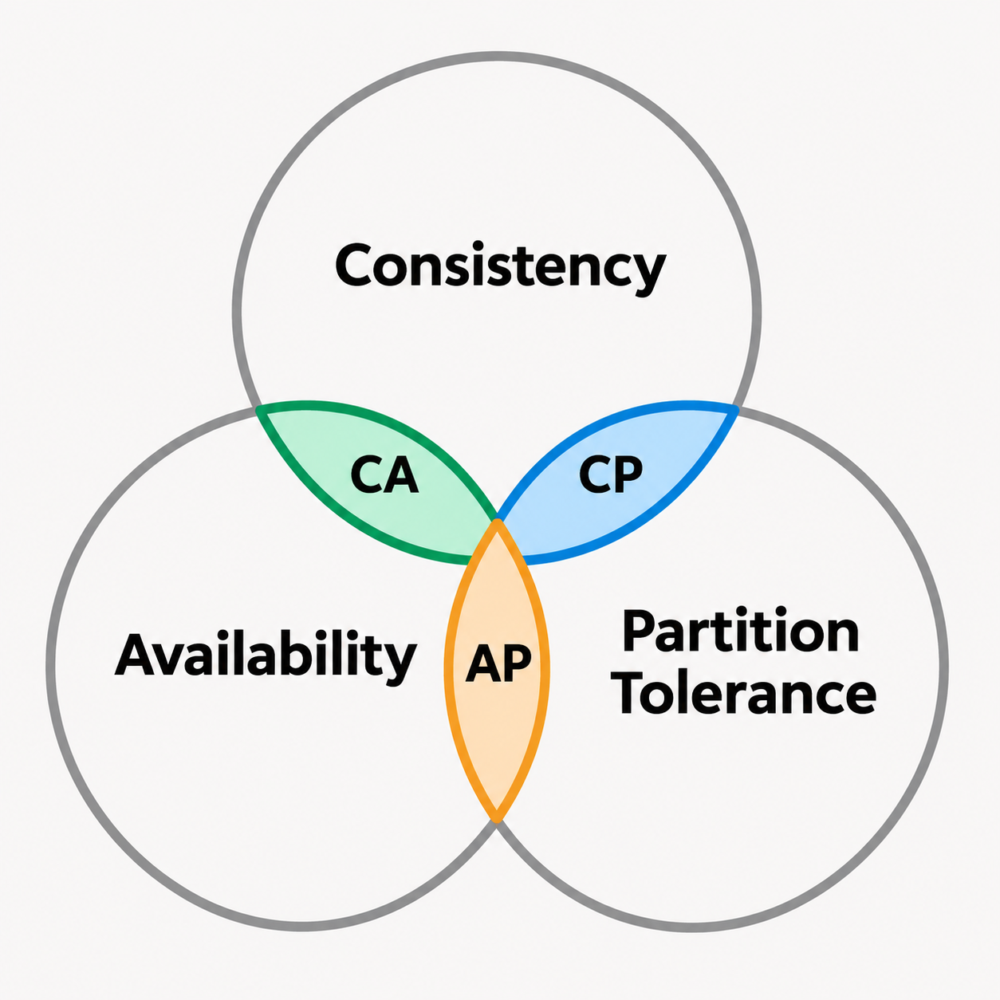

분산 시스템을 이해하려면 먼저 짚고 넘어가야 할 이론이 몇 가지 있습니다.

- CAP 정리
- PACELC 정리
- 비잔티움 장군 문제
- FLP 불가능성 정리

이 이론들은 합의 프로토콜, 분산 알고리즘, 장애 허용성을 이해하는 바탕이 됩니다. 이번 글에서는 CAP 정리와 PACELC 정리에서 출발해, 여러 노드가 하나의 값에 합의하는 팩소스와 래프트 알고리즘, 비잔티움 장군 문제, FLP 불가능성 정리를 차례로 살펴보겠습니다. 이어서 분산 시스템에서 자주 쓰는 데이터 구조인 일관된 해싱, 블룸 필터, 카운트-민 스케치, 하이퍼로그로그를 다룹니다.

## CAP 정리(브루어의 정리)

CAP 정리는 분산 시스템이 일관성, 가용성, 파티션 허용성 세 가지를 동시에 만족할 수 없다는 정리입니다.

### 네트워크 파티션이 생기면

분산 시스템에서는 하드웨어 고장, 네트워크 장애, 시스템 점검 같은 이유로 네트워크 파티션이 생길 수 있습니다. 파티션이 생기면 서버끼리 더 이상 데이터를 주고받지 못하고, 시스템 안의 노드가 서로 통신할 수 없는 여러 그룹으로 나뉩니다.

이때 시스템은 일관성과 가용성 중 무엇을 우선할지 정해야 합니다. 가용성과 파티션 허용성을 고르면 시스템은 계속 동작하지만, 모든 노드가 같은 데이터를 유지한다는 보장은 포기해야 합니다. 반대로 일관성과 파티션 허용성을 고르면 데이터는 어긋나지 않지만, 일부 노드가 사용자 요청을 처리하지 못합니다.

### 왜 둘 다 지킬 수 없을까

그렇다면 파티션 상황에서 가용성과 일관성을 함께 지킬 방법은 없을까요? 파티션이 생기면 노드끼리 서로의 상태를 확인할 길이 끊기기 때문에 불가능합니다.

예를 들어 노드 A와 B가 같은 데이터 `x=1`을 갖고 있는데, 둘 사이 네트워크가 끊겼다고 가정해 보겠습니다.

1. 클라이언트1이 A에 `x=2`를 씁니다. A는 이 값을 B에 전달하려 하지만 파티션 때문에 전달되지 않습니다.
2. 클라이언트2가 B에서 `x`를 읽으려고 합니다.

이때 B가 할 수 있는 선택은 두 가지입니다. 가지고 있는 값 `x=1`을 바로 돌려주면 응답은 했으니 가용성은 지켜지지만, A에는 이미 `x=2`가 쓰였으므로 일관성이 깨집니다. 반대로 A와 연락이 닿을 때까지 응답을 미루거나 에러를 돌려주면 오래된 값을 주지 않으니 일관성은 지켜지지만, 멀쩡히 살아 있는 노드가 요청에 응답하지 못하므로 가용성이 깨집니다.

CAP 정리: 세 가지 중 동시에 지킬 수 있는 건 두 가지뿐

## PACELC 정리

PACELC 정리는 CAP 정리를 확장한 개념입니다. CAP 정리는 파티션이 생겼을 때의 선택만 다루지만, 실제 시스템은 파티션이 없는 평상시에도 무언가를 포기하며 동작합니다. PACELC는 이 부분까지 함께 설명합니다.

이름의 각 글자는 다음을 뜻합니다.

- P(Partition): 네트워크 파티션이 생긴 상황입니다.
- A(Availability): 가용성. 시스템에 보낸 요청이 결국 응답을 받도록 보장하는 성질입니다.
- C(Consistency): 일관성. 모든 노드가 같은 데이터를 보도록 하는 성질입니다.
- E(Else): 그 외, 즉 파티션이 없는 평상시입니다.
- L(Latency): 지연 시간. 요청을 보내고 응답을 받기까지 걸리는 시간입니다.

정리하면 파티션이 생기면 가용성과 일관성 중 하나를 고르고, 그렇지 않으면 지연 시간과 일관성 중 하나를 골라야 한다는 뜻입니다. 파티션 상황의 선택은 CAP 정리와 같습니다. 다른 점은 평상시에도 선택이 필요하다는 것입니다. 강한 일관성을 지키려면 쓰기가 여러 노드에 복제되기를 기다려야 하므로 지연 시간이 늘어나고, 지연 시간을 줄이려면 복제가 끝나기 전에 응답해야 하므로 일관성이 약해집니다. 그래서 많은 분산 데이터베이스는 요청마다 원하는 일관성 수준을 고를 수 있게 해 둡니다.

분산 시스템에서 여러 서버가 함께 일하려면 노드끼리 어떤 값에 합의할 수 있어야 합니다. 이 합의를 위한 대표적인 알고리즘이 팩소스와 래프트입니다.

## 팩소스 알고리즘

팩소스는 노드 장애나 메시지 유실 같은 문제가 생기더라도 분산 시스템이 하나의 값에 합의할 수 있도록 하는 알고리즘입니다. 여기서 하나의 값이란 시스템 안의 모든 노드가 동의해야 하는 특정 데이터나 결정을 말합니다.

### 팩소스를 이루는 역할

팩소스에서 노드는 다음 역할을 맡습니다.

- 제안자: 합의 과정을 시작하는 노드입니다. 합의할 값을 제안하고 다른 노드에 전파합니다.
- 수용자: 제안자의 제안을 받아 수락할지 결정하고, 수락한 결과를 다른 노드에 알립니다.
- 학습자: 합의된 값을 최종적으로 전달받는 노드입니다. 이 값을 바탕으로 이후 작업을 수행합니다.

### 팩소스 프로토콜 과정

팩소스는 준비 단계와 수용 단계를 거쳐 합의에 이릅니다.

준비 단계에서 제안자는 다른 제안과 겹치지 않는 고유한 제안 번호를 골라 수용자들에게 준비 요청을 보냅니다. 수용자는 이 번호가 지금까지 받은 어떤 준비 요청보다 높으면, 앞으로 이보다 낮은 번호의 제안은 받지 않겠다고 약속하며 응답합니다. 이미 수락한 제안이 있다면 그중 번호가 가장 높은 제안의 번호와 값을 응답에 함께 담습니다.

수용 단계에서 제안자는 과반수의 수용자에게 응답을 받으면 제안 번호와 값을 담아 수용 요청을 보냅니다. 이때 응답 중에 이미 수락된 값이 있었다면 자기 값 대신 그 값을 제안해야 합니다. 과반수의 수용자가 이 제안을 수락하면 합의가 이루어지고 해당 값이 선택됩니다.

팩소스를 설계할 때는 몇 가지를 함께 고려해야 합니다. 먼저 일부 노드가 멈추거나 네트워크에서 떨어져 나가도 시스템이 계속 동작해야 합니다. 또 팩소스의 성능은 노드 수에 영향을 받으므로 규모가 커질수록 확장성을 따져 봐야 합니다. 프로토콜 자체가 복잡하기 때문에 모든 참여자가 규칙을 정확히 따르도록 설계하는 것도 중요합니다.

### 은행 계좌 예시로 이해하기

은행 계좌 잔액을 예로 들어 보겠습니다. 노드 A, B, C, D는 각각 계좌 잔액을 조회하고 업데이트할 수 있는 독립적인 서버입니다. 고객이 계좌에서 1000달러를 출금하면, 은행의 모든 서버는 이후 같은 잔액을 보여 줄 수 있어야 합니다.

#### 합의에 성공하는 경우

- 1단계: 출금 요청이 들어오면 제안자가 제안을 시작합니다.
  - 노드 A가 제안자를 맡아 합의 과정을 시작합니다.
  - 노드 A는 출금 후 잔액을 모든 노드에 맞추기 위해 제안 번호를 담은 준비 요청을 보냅니다.
- 2단계: 수용자들이 제안을 검토하고 응답합니다.
  - 노드 B, C, D가 노드 A의 준비 요청을 받습니다.
  - 각 수용자는 이 제안 번호가 지금까지 받은 번호 중 가장 높으면 기록해 두고, 노드 A에 응답합니다.
  - 노드 D가 네트워크 오류로 응답하지 못하더라도 B와 C로 과반수의 응답이 모였으므로 다음 단계로 넘어갑니다.
- 3단계: 제안자가 최종 수용 요청을 보냅니다.
  - 과반수의 응답을 받은 노드 A는 새 잔액을 담아 수용 요청을 보냅니다.
  - 노드 B와 C는 이를 수락해 잔액을 업데이트하고 응답합니다.
- 4단계: 합의가 끝나고 잔액이 확정됩니다.
  - 노드 A는 합의가 끝났음을 알리고, 학습자 역할을 맡은 노드 D에 업데이트된 잔액을 전달합니다.

#### 합의에 실패하는 경우

- 경합이 생깁니다.
  - 노드 A가 수용 요청을 보내기 전에 노드 B가 더 높은 번호로 다른 제안을 시작합니다.
- 수용자가 새 제안을 고릅니다.
  - 노드 C와 D는 번호가 더 높은 노드 B의 제안을 받아들이고, 뒤늦게 도착한 노드 A의 수용 요청은 거부합니다.
- 합의에 실패한 제안자가 다시 시도합니다.
  - 노드 A는 더 높은 제안 번호를 골라 출금 요청을 다시 시작합니다.
  - 제안 번호가 계속 높아지기 때문에 대부분은 이 과정을 거쳐 하나의 값으로 합의하게 됩니다.

다만 두 제안자가 번갈아 더 높은 번호를 내면 서로의 제안을 계속 무효로 만들어 합의가 끝나지 않을 수도 있습니다. 그래서 실제 구현에서는 제안자 하나를 리더로 정하거나, 재시도하기 전에 임의의 시간만큼 기다리게 해서 이런 상황을 피합니다.

### 팩소스의 최적화와 발전 방향

- 멀티 팩소스: 기본 팩소스를 확장해 여러 값에 대해 연속으로 합의할 수 있게 한 방식입니다. 리더가 한 번 정해지면 이후 값부터는 준비 단계를 반복하지 않아도 되므로, 요청 오버헤드가 줄고 다음 값에 대한 합의가 빨라집니다.
- 패스트 팩소스: 합의에 필요한 메시지 수를 줄인 팩소스입니다. 값을 수용자에게 바로 제안할 수 있게 해서 합의에 이르는 시간을 줄입니다.
- 심플 팩소스: 원래 팩소스를 단순화하는 것이 목표입니다. 준비 단계와 수용 단계를 하나의 라운드로 합쳐 메시지 교환 수를 줄이고, 프로토콜을 이해하기 쉽게 만드는 데 중점을 둡니다.

### 팩소스 활용 사례

- 분산 데이터베이스: 복제된 데이터베이스 사이의 일관성과 내구성을 확보하는 데 쓰입니다. 성공한 트랜잭션의 순서를 정하고 장애를 효과적으로 처리할 수 있습니다. 구글 스패너가 대표적입니다.
- 분산 파일 시스템: 여러 노드 사이에서 메타데이터의 일관성과 가용성을 유지하는 데 쓰입니다.
- 상태 기계 복제: 노드 클러스터가 작업 순서에 합의해 레플리카 사이의 일관성을 유지합니다. 덕분에 분산 키-값 저장소 같은 시스템에서 장애 허용성과 복제가 가능해집니다. 구글의 분산 잠금 서비스인 처비도 이 방식으로 상태를 복제합니다.

## 래프트 알고리즘

래프트는 팩소스의 대안으로 나온 합의 알고리즘으로, 분산 합의를 더 단순하고 이해하기 쉽게 만드는 데 초점을 둡니다. 래프트에서 노드는 다음 세 상태 중 하나에 있습니다.

- 리더: 클러스터에 하나만 있는 노드입니다. 합의 과정을 관리하고 로그 항목을 다른 노드에 복제하도록 지시합니다.
- 추종자: 리더의 로그를 복제하고 리더의 요청에 응답하는 수동적인 노드입니다. 합의 과정에서 리더의 지시를 따릅니다.
- 후보자: 리더가 실패해 새 리더를 뽑아야 할 때, 추종자는 후보자 상태로 바뀌어 선거에 나섭니다.

### 래프트 프로토콜 과정

- 리더 선출: 시스템이 시작되거나 리더가 없으면 새 리더를 뽑습니다. 노드가 후보자 상태로 바뀌어 다른 노드에 투표 요청 메시지를 보내고, 과반수의 표를 얻으면 리더가 됩니다.
- 로그 복제: 리더는 클라이언트 요청을 받아 자기 로그에 추가하고, 그 로그 항목을 추종자에게 복제합니다. 과반수의 노드에 복제된 항목은 커밋된 것으로 봅니다.
- 안전성 보장: 최신 로그를 가진 노드만 리더로 뽑힐 수 있다는 투표 규칙, 로그를 추가할 때 바로 앞 항목이 일치하는지 확인하는 규칙 같은 장치로 안전성과 일관성을 지킵니다.

래프트를 쓸 때도 고려할 점이 있습니다. 래프트는 리더가 모든 요청을 처리하기 때문에 리더가 살아 있어야 시스템이 동작합니다. 추종자는 일정 시간 동안 리더의 신호를 받지 못하면 리더에 문제가 생겼다고 보고 새 선거를 시작하는데, 이 덕분에 리더가 죽어도 시스템이 스스로 회복하며 장애 허용성을 확보합니다. 다만 선거가 끝날 때까지는 쓰기 요청을 처리할 수 없습니다. 또 시스템이 커지고 노드가 늘어나면 리더가 주고받아야 할 메시지가 많아져 성능이 떨어지므로, 상황에 맞는 최적화와 설정 조정이 필요합니다.

### 래프트 활용 사례

- 분산 데이터베이스: 레플리카 사이의 일관성과 내구성을 유지하는 데 쓰입니다.
- 분산 파일 시스템: 여러 노드에 흩어진 파일 메타데이터의 일관성과 가용성을 유지하는 데 쓰입니다. 장애가 생겨도 모든 레플리카가 파일 시스템 상태를 똑같이 유지할 수 있습니다.
- 클러스터 관리와 서비스 디스커버리: 리더 선출이나 서비스 디스커버리처럼 노드끼리 협력하고 합의해야 하는 작업에 쓰입니다.
- 강한 일관성이 필요한 분산 시스템: 모든 노드가 같은 순서로 같은 결정을 내려야 하는 시스템을 만들 때 기반이 됩니다.
- 클라우드 인프라 관리 시스템: 자원 할당, 장애 대응, 오토스케일링처럼 분산된 구성 요소들이 협력하고 합의해야 하는 작업에 쓰입니다.

## 비잔티움 장군 문제

비잔티움 장군 문제는 신뢰성과 장애 허용성을 이야기할 때 빠지지 않는 사고 실험입니다. 시스템을 이루는 구성 요소 중 일부가 오류를 일으키거나 잘못된 명령을 전달할 때, 나머지가 어떻게 정상적으로 동작할 수 있는지를 다룹니다.

비잔티움 제국의 장군들이 각자 군대를 이끌고 적의 도시를 둘러싸고 있다고 가정해 보겠습니다. 장군들은 다 함께 공격하거나 다 함께 후퇴해야 하고, 일부만 움직이면 패배합니다. 문제는 장군 중에 배신자가 섞여 있다는 점입니다.

앞에서 본 팩소스와 래프트는 노드가 멈추거나 메시지가 유실되는 장애만 가정합니다. 비잔티움 장군 문제는 여기서 한 걸음 더 나아가, 노드가 거짓 정보를 퍼뜨리는 상황까지 다룹니다.

### 통일된 명령을 따르기 어려운 이유

거짓 정보가 오가는 상황에서 모두가 하나의 명령을 믿고 따르기는 쉽지 않습니다. 장군들은 전령을 통해서만 소통할 수 있는데, 전령은 도중에 붙잡히거나 메시지를 전달하지 못할 수 있습니다. 일부 장군은 배신자여서 일부러 합의를 방해할 수 있고, 장군들은 누가 충신이고 누가 배신자인지 겉으로는 구별할 수 없습니다. 게다가 배신자끼리 서로 공모해, 충성스러운 장군들이 합의에 이르지 못하도록 방해할 수도 있습니다.

### 합의를 위한 조건

그렇다면 배신자가 섞여 있어도 합의할 수 있으려면 어떤 조건이 필요할까요?

먼저 충성스러운 장군이 충분히 많아야 합니다. 전체 장군 수를 N, 배신자 수를 F라고 하면 `N ≥ 3F + 1`, 즉 배신자가 전체의 3분의 1보다 적어야 합니다. 예를 들어 장군이 4명이면 배신자 1명까지 견딜 수 있습니다. 노드가 멈추기만 하는 장애라면 과반수만 살아 있으면 되지만, 거짓말을 하는 노드까지 견디려면 이보다 많은 정상 노드가 필요합니다.

또 충성스러운 장군들이 합의에 이를 만큼의 시간이 보장되어야 합니다. 메시지가 언제 도착할지 전혀 알 수 없다면 늦게 오는 장군과 배신한 장군을 구별할 수 없기 때문입니다.

### 해결 방법

- 투표 알고리즘: 3분의 2 이상이 찬성하면 해당 계획에 합의한 것으로 보는 방식입니다.
- 서명 방식: 장군들은 메시지에 서명해 찬성을 표시합니다. 서명은 위조할 수 없으므로 배신자가 다른 장군의 명령을 꾸며 낼 수 없고, 여러 라운드를 거치며 일관되지 않은 메시지를 보낸 배신자를 걸러 낼 수 있습니다.
- 쿼럼 방식: 쿼럼은 합의나 의사 결정에 필요한 최소한의 동의 인원을 말합니다. 쿼럼 크기를 충분히 크게 잡아 두면 어떤 두 쿼럼이든 충성스러운 장군을 적어도 한 명 공유하게 되어, 서로 다른 두 결정이 동시에 내려지는 일을 막을 수 있습니다.
- 타임아웃과 확인 절차: 장군들은 계획을 제안하고 투표를 진행하는데, 정해진 시간 안에 응답하지 않는 장군은 의심 대상으로 표시합니다.
- 무작위 선택 방식: 장군들은 임의의 난수를 담아 계획을 제안합니다. 배신자는 이 난수를 미리 알 수 없으므로, 투표 내용에서 난수를 정확히 맞춘 장군은 충신일 가능성이 높다고 판단합니다.

이런 기법을 바탕으로 비잔티움 장애를 견디도록 만든 합의 알고리즘을 비잔티움 장애 허용 알고리즘이라고 부르며, 참여자를 믿을 수 없는 블록체인 같은 시스템에서 주로 쓰입니다.

### 최신 비잔티움 장애 허용성

초기의 비잔티움 장애 허용 알고리즘은 통신 비용이 컸습니다. 대표 격인 PBFT는 합의 과정에서 모든 노드가 서로 메시지를 주고받아야 해서, 노드가 늘어날수록 통신량이 노드 수의 제곱에 비례해 불어납니다. 그래서 노드가 많은 대규모 네트워크에서는 쓰기 어려웠습니다.

최신 비잔티움 장애 허용 알고리즘은 이 통신 비용을 줄여 대규모 네트워크에서도 효율적으로 동작하도록 발전했습니다. 예를 들어 핫스터프는 노드끼리 직접 주고받던 투표를 리더가 모아 한 번에 전달하도록 바꿔, 통신량을 노드 수에 비례하는 수준으로 낮췄습니다.

## FLP 불가능성 정리

FLP 불가능성 정리는 완전한 비동기 환경에서는 노드가 단 하나만 멈출 수 있어도, 모든 노드가 같은 결정을 내리도록 항상 보장하는 결정론적 합의 알고리즘을 만들 수 없다는 정리입니다. 1985년 이 정리를 증명한 피셔, 린치, 패터슨 세 사람의 이름 첫 글자를 따서 FLP라고 부릅니다.

이 정리는 다음 전제 위에서 성립합니다.

- 비동기성: 메시지가 도착하기까지 걸리는 시간이나 프로세스의 처리 속도에 상한이 없습니다. 프로세스는 메시지로만 통신하고, 서로 같은 시계를 공유하지 않습니다.
- 프로세스 장애: 전체 프로세스 중 일부가 동작을 멈출 수 있습니다. 불가능성을 보이는 데는 하나만 멈춰도 충분합니다.
- 유한한 단계: 각 프로세스는 정해진 유한한 단계만 수행하고, 메시지 크기도 제한되어 있습니다.

핵심은 비동기 시스템에서는 느리게 응답하는 프로세스와 실제로 멈춘 프로세스를 구별할 방법이 없다는 점입니다. 응답을 기다리면 멈춘 노드 때문에 영원히 결정을 내리지 못할 수 있고, 기다리지 않고 결정하면 느렸을 뿐인 노드가 다른 결정을 내릴 수 있습니다. 앞에서 두 제안자가 번갈아 번호를 올리면 팩소스의 합의가 끝나지 않을 수 있다고 했던 것도 같은 한계에서 나옵니다.

그렇다면 실제 시스템은 이 한계를 어떻게 피할까요? 정리가 기대고 있는 전제 중 하나를 완화하는 방법을 씁니다.

- 메시지 지연 시간에 상한을 둡니다. 정해진 시간 안에 응답이 없으면 장애로 보는 방식으로, 래프트가 타임아웃으로 리더 장애를 감지하는 것이 이 경우입니다.
- 높은 확률로 합의에 도달하는 확률적 알고리즘을 씁니다. 결정론적 알고리즘이라는 전제를 벗어나는 방법입니다.
- 무작위 요소나 시간 동기화 방식을 도입합니다.
- 리더를 선출하거나 조정자 역할을 두어, 제안이 서로 부딪히는 상황을 줄입니다.

결국 FLP 불가능성 정리는 특정 조건에서 분산 시스템이 할 수 있는 것과 할 수 없는 것의 경계를 보여 주는 이론적 기준입니다. 팩소스와 래프트가 어떤 상황에서도 잘못된 값에 합의하지는 않지만, 합의가 언제 끝나는지는 보장하지 못하는 이유이기도 합니다.

## 일관된 해싱

지금까지 분산 시스템의 바탕이 되는 이론을 살펴봤다면, 여기서부터는 분산 시스템에서 자주 쓰는 데이터 구조를 하나씩 살펴보겠습니다.

일관된 해싱은 분산 시스템에서 데이터를 여러 노드에 고르게 나누면서, 노드를 추가하거나 삭제할 때 다른 노드로 옮겨야 하는 데이터를 최소화하는 방식입니다. 덕분에 시스템을 늘리거나 줄이기 쉬워지고, 노드에 장애가 생겨도 영향받는 데이터가 적어 장애 허용성도 높아집니다.

일관된 해싱이 왜 필요한지 보려면, 먼저 가장 단순한 분배 방식인 모듈로 해싱부터 살펴봐야 합니다.

### 모듈로 해싱 방식

모듈로 해싱은 데이터 키를 해시 값으로 바꾼 뒤, 그 값을 노드 개수로 나눈 나머지로 데이터를 저장할 노드를 정하는 방식입니다. 노드가 4개라면 해시 값이 10인 키는 `10 % 4 = 2`이므로 2번 노드에 저장됩니다.

이 방식은 노드나 버킷의 수가 고정되어 있다는 전제 위에서만 잘 동작합니다. 노드를 추가하거나 삭제하면 나누는 수가 바뀌고, 그에 따라 키가 배정되는 노드도 대부분 바뀝니다. 앞의 예에서 노드를 5개로 늘리면 같은 키는 `10 % 5 = 0`이 되어 0번 노드로 옮겨 가야 합니다. 이렇게 노드를 4개에서 5개로 늘리기만 해도 전체 키의 약 80%가 다른 노드로 옮겨 가야 합니다.

노드 하나가 바뀔 때마다 이만큼의 데이터를 다시 매핑하고 재분배해야 하니 시간이 오래 걸리고 리소스도 많이 듭니다. 데이터가 옮겨지는 동안에는 요청을 제대로 처리하지 못해 시스템 가용성도 떨어질 수 있습니다.

### API 요청을 서버에 나눠 주는 예시

일관된 해싱은 데이터 키와 서버를 같은 해시 함수에 넣어, 가장 큰 값 다음이 다시 0으로 이어지는 원형의 해시 링 위에 올려 둡니다. 그리고 키의 위치에서 시계 방향으로 돌다가 처음 만나는 서버에 그 키를 맡깁니다. 클라이언트의 API 요청을 서버에 나눠 주는 상황에 적용해 보겠습니다. 시스템에 server0부터 server3까지 서버 4대가 있다고 가정합니다.

클라이언트가 `GET /users/42`를 보내면 로드밸런서나 라우팅 계층이 요청에서 키를 뽑습니다. 여기서는 유저 ID인 `user:42`가 키입니다. 로드밸런서는 `hash("user:42")`를 계산해 링 위의 위치를 구하고, 그 위치에서 시계 방향으로 돌다가 처음 만나는 server3에 요청을 넘깁니다. 같은 유저가 다시 요청을 보내도 해시 값이 같으므로 요청은 항상 server3으로 갑니다.

그렇다면 서버 구성이 바뀌면 어떻게 될까요? server3에 장애가 나면 `user:42`는 시계 방향으로 다음 서버인 server0으로 넘어가고, server1과 server2가 받던 요청은 그대로입니다. 새로 server4를 추가하는 경우에도 링에서 server4가 자리 잡은 위치와 바로 앞 서버 사이 구간의 요청만 server4로 옮겨 가고, 나머지 요청은 영향을 받지 않습니다.

### 가상 노드로 부하 나누기

다만 이 구조에는 약점이 있습니다. 서버 하나가 다운되면 시계 방향으로 다음에 있는 서버 하나가 그 서버의 요청을 모두 떠안게 됩니다. 앞의 예에서 server3이 다운되면 server3이 맡던 구간 전체가 server0으로 넘어갑니다. 갑자기 늘어난 요청 때문에 server0에 과부하가 걸려 함께 다운되면, 그 부담이 다시 다음 서버로 넘어가며 연쇄 장애로 이어질 수 있습니다.

이를 완화하기 위해 서버마다 가상 노드를 여러 개 만들어 해시 링의 여러 위치에 흩어 놓습니다. 물리 서버는 4대 그대로지만, 링 위에서는 서버 하나가 여러 지점을 나눠 맡는 셈입니다.

그림처럼 서버마다 가상 노드를 3개씩 두면, server3이 다운되더라도 링에서 server3의 지점 세 개만 사라집니다. 각 지점이 맡던 구간은 저마다 시계 방향 다음에 있는 서버로 넘어가는데, 그 서버가 server0, server1, server2로 제각각이라 부하가 서버 하나에 몰리지 않고 남은 서버들에 고르게 나뉩니다. 가상 노드를 많이 둘수록 서버마다 맡는 구간의 크기도 비슷해져, 평소에도 요청이 더 고르게 분배됩니다.

## 블룸 필터

블룸 필터는 메모리를 적게 쓰면서 어떤 원소가 집합에 속해 있는지 빠르게 확인할 수 있는 데이터 구조입니다. 다만 확실하게 답할 수 있는 것은 집합에 없다는 사실뿐이고, 있다는 답은 있을 가능성이 있다는 뜻입니다. 그래서 정확한 확인은 데이터베이스에 맡기고, 확실히 없는 요청을 앞단에서 걸러 내는 용도로 많이 씁니다.

### 동작 방식

블룸 필터는 0으로 초기화한 m비트 배열과 해시 함수 k개로 이루어집니다. 원소 자체는 저장하지 않습니다.

원소를 추가할 때는 원소를 k개의 해시 함수에 넣고, 나온 k개 위치의 비트를 1로 바꿉니다. 원소가 있는지 조회할 때는 같은 k개 위치를 확인합니다. 하나라도 0이면 그 원소는 추가된 적이 없는 것이 확실하고, 전부 1이면 아마 있다고 판단합니다.

### 회원 가입 여부로 살펴보기

가입한 유저인지 확인하는 상황을 예로 들어 보겠습니다. 12칸짜리 비트 배열과 해시 함수 3개를 쓰는 블룸 필터입니다.

먼저 user:42가 가입하면 user:42를 해시 함수 3개에 넣습니다. 결과가 2, 5, 10번째 칸이므로 이 세 칸을 1로 바꿉니다. 이어서 user:7이 가입하면 같은 방식으로 5, 7, 12번째 칸을 1로 바꿉니다. 5번째 칸은 user:42가 이미 1로 바꿔 두었으므로 그대로 1입니다. 이제 1인 칸은 2, 5, 7, 10, 12번째입니다.

이번에는 가입한 적 없는 user:99의 프로필 요청이 들어왔다고 해 보겠습니다. 해시 함수 3개를 돌리니 3, 7, 10번째 칸이 나옵니다. 7번째와 10번째는 1이지만 3번째는 0입니다. user:99가 가입했다면 3번째 칸이 1이었을 테니, 가입한 적이 없다는 것이 확실합니다. 그래서 데이터베이스에 가지 않고 바로 없는 유저라고 응답합니다. 블룸 필터가 제 역할을 한 경우입니다.

그렇다면 가입하지 않은 유저는 항상 이렇게 걸러 낼 수 있을까요? user:13도 가입한 적이 없지만, 해시 함수 3개를 돌리니 7, 10, 12번째 칸이 나왔고 세 칸이 모두 1입니다. 7번째와 12번째는 user:7이, 10번째는 user:42가 바꿔 놓은 칸인데 우연히 겹친 것입니다. 필터는 어떤 원소가 비트를 바꿨는지 구분하지 못하므로 있을 수도 있다고 판단합니다. 결국 데이터베이스를 조회해 없다는 것을 확인한 뒤에야 없는 유저라고 응답합니다. 최종 응답은 틀리지 않았지만, 필터가 걸러 주지 못해 데이터베이스 조회를 한 번 낭비했습니다. 이처럼 없는 원소를 있을 수도 있다고 판단하는 경우를 거짓 양성이라고 합니다.

세 유저를 조회한 결과를 정리하면 다음과 같습니다.

| 조회한 유저 | 실제 가입 여부 | 확인한 칸                | 필터 판정                    | 데이터베이스 조회 |
| :---------: | :------------: | :----------------------- | :--------------------------- | :---------------: |
|   user:99   |     미가입     | 3, 7, 10번째 (3번째가 0) | 확실히 없음                  |       안 함       |
|   user:13   |     미가입     | 7, 10, 12번째 (모두 1)   | 있을 수도 있음 (거짓 양성)   |     함 (낭비)     |
|   user:42   |      가입      | 2, 5, 10번째 (모두 1)    | 있을 수도 있음 (실제로 있음) |        함         |

### 블룸 필터의 성질

- 거짓 음성이 없습니다: 추가한 원소는 해당 칸이 모두 1이므로 반드시 있을 수도 있다는 판정이 나옵니다. 그래서 필터가 없다고 답하면 그대로 믿어도 됩니다.
- 거짓 양성이 있습니다: 앞의 user:13처럼 추가한 적이 없어도, 다른 원소들이 바꿔 놓은 비트가 우연히 겹치면 있을 수도 있다는 판정이 나옵니다. 비트 배열에 비해 원소가 많아질수록 1인 칸이 늘어나 거짓 양성도 잦아지므로, 예상되는 원소 수에 맞춰 배열 크기를 정해야 합니다.
- 원소를 삭제할 수 없습니다: 비트 하나를 여러 원소가 함께 쓰기 때문에, 한 원소를 지우려고 비트를 0으로 되돌리면 다른 원소의 판정까지 깨집니다. 삭제가 필요하면 비트 대신 카운터를 두는 카운팅 블룸 필터나 쿠쿠 필터를 씁니다.
- 메모리를 적게 씁니다: 원소 크기와 상관없이 원소당 약 10비트에 해시 함수 7개를 쓰면 거짓 양성 비율을 1% 정도로 맞출 수 있습니다.

## 카운트-민 스케치

블룸 필터가 원소가 있는지 없는지를 답한다면, 카운트-민 스케치는 원소가 몇 번 나타났는지를 답합니다. 카운트-민 스케치는 데이터 스트림에서 각 요소의 빈도를 추정하는 확률적 데이터 구조입니다. 요소마다 정확한 횟수를 따로 세지 않고 빈도 분포를 근사적으로 표현하기 때문에 메모리를 적게 씁니다. 그래서 메모리가 제한되어 있거나, 실시간 인기 검색어 집계처럼 대규모 데이터 스트림을 실시간으로 처리해야 하는 상황에서 효과적입니다.

카운트-민 스케치는 카운터로 이루어진 이차원 배열입니다. 행의 수 d는 해시 함수의 개수이고, 열의 수 w는 한 행에 있는 카운터의 개수입니다. 두 값은 원하는 정확도와 오류율에 맞춰 정합니다.

스트림에 요소가 나타나면 d개의 해시 함수를 모두 실행해 행마다 카운터 위치를 하나씩 정하고, 그 위치의 카운터를 1씩 올립니다. 빈도를 조회할 때는 같은 위치의 카운터 d개를 읽어 그중 최솟값을 추정값으로 씁니다. 이름의 민이 바로 이 최솟값을 뜻합니다.

### 알파벳 빈도로 살펴보기

알파벳 A, B, C, D가 섞여 들어오는 스트림을 예로 들어 보겠습니다. 해시 함수는 5개(d = 5), 행마다 카운터는 10개(w = 10)입니다.

그림은 A가 3번, B가 2번, C가 1번, D가 4번 들어온 뒤의 상태입니다. 각 칸의 큰 숫자는 카운터 값이고, 아래의 작은 글자는 그 칸을 올린 요소입니다. 해시 위치는 설명을 위해 임의로 정했습니다.

A가 한 번 들어오면 h1부터 h5까지 해시 함수를 모두 돌려 행마다 한 칸씩, 모두 다섯 칸을 1씩 올립니다. A의 위치는 h1에서 1번, h2에서 3번, h3에서 0번, h4에서 6번, h5에서 8번 칸입니다. A가 3번 들어왔으니 이 다섯 칸이 각각 3씩 올라갑니다. B, C, D도 같은 방식으로 기록됩니다.

그런데 한 행에 칸이 10개뿐이라 서로 다른 요소가 같은 칸에 떨어지기도 합니다. h1의 1번 칸에는 A의 3과 D의 4가 더해져 7이 되었고, h2의 3번 칸에는 A와 B가 겹쳐 5가 되었습니다. h4의 6번 칸은 A와 C가 겹쳐 4, h5의 4번 칸은 C와 D가 겹쳐 5입니다.

그렇다면 A의 빈도를 물었을 때 왜 최솟값을 답할까요? A가 가리키는 다섯 칸을 읽으면 7, 5, 3, 4, 3입니다. 충돌은 카운터 값을 키우기만 하고 줄이지는 않으므로, 가장 작은 값이 충돌의 영향을 가장 덜 받은 값입니다. 그래서 최솟값 3을 추정값으로 고르고, 이는 실제 횟수와 일치합니다. 같은 방식으로 조회하면 B는 2, C는 1, D는 4로 모두 정확하게 나옵니다.

### 충돌이 추정값을 부풀리는 문제

카운트-민 스케치의 정확도는 카운터 수와 해시 함수 개수에 달려 있습니다. 카운터를 늘리면 정확도는 올라가지만 그만큼 메모리를 더 씁니다.

칸 수가 유한한 이상 충돌 자체는 피할 수 없습니다. 문제는 충돌이 추정값을 부풀린다는 점이고, 값이 틀려도 스케치는 틀렸다는 신호를 주지 않습니다. 앞의 예시에서 행이 h1 하나뿐이었다면 A의 추정값은 실제 3이 아니라 7이 됩니다. 같은 칸을 쓰는 D의 4가 더해졌기 때문입니다. 지금 A의 값이 맞은 것은 h3과 h5에서 A가 충돌 없이 혼자 칸을 썼기 때문입니다. 즉 한 행이라도 충돌하지 않으면 정확하고, 모든 행에서 충돌하면 그만큼 부풀려집니다.

이 성질 때문에 실제로는 다음과 같은 문제가 생깁니다.

- 드문 요소가 흔한 것처럼 보입니다: 오차의 크기는 같은 칸에 떨어진 다른 요소의 빈도로 정해집니다. 그래서 실제로 1번 나온 요소가 100만 번 나온 요소와 모든 행에서 겹치면 1,000,001번 나온 것처럼 보입니다. 반대로 빈도가 큰 요소는 오차가 상대적으로 작아 거의 정확합니다.
- 한 번도 들어오지 않은 요소도 0이 아닌 값이 나옵니다: 조회한 칸들을 다른 요소가 올려 두었다면 양수가 나옵니다.
- 스트림이 길어질수록 오차가 커집니다: 오차의 상한이 전체 건수 N에 비례하기 때문입니다. 칸 수는 고정인데 값은 계속 쌓이므로, 오래 돌릴수록 추정값이 부풀려지는 폭도 커집니다.

### 오차를 줄이는 방법

- w를 키웁니다: 칸이 많아져 충돌 자체가 줄고 오차 폭이 줄어듭니다.
- d를 키웁니다: 모든 행에서 동시에 충돌할 확률이 줄어듭니다.
- 보수적 업데이트를 씁니다: 요소가 들어올 때 d개의 칸을 모두 올리지 않고 현재 값이 최솟값인 칸만 올립니다. 과대 추정이 눈에 띄게 줄지만, 카운터를 줄이는 삭제는 지원할 수 없게 됩니다.
- 주기적으로 감쇠하거나 윈도우를 둡니다: 일정 주기마다 카운터를 절반으로 줄이거나 초기화해 N이 끝없이 커지는 것을 막습니다.
- 정확한 값이 필요한 상위 항목은 따로 셉니다: 스케치로 후보를 추린 뒤, 상위 K개만 힙이나 해시맵으로 정확하게 셉니다.

## 하이퍼로그로그

카운트-민 스케치가 원소마다 몇 번 나왔는지를 센다면, 하이퍼로그로그는 서로 다른 원소가 모두 몇 개인지를 셉니다. 하이퍼로그로그는 집합 안에서 중복되지 않은 요소의 개수, 즉 카디널리티를 아주 적은 메모리로 추정하는 확률적 알고리즘입니다. 집합의 크기와 상관없이 고정된 양의 메모리만으로 카디널리티를 근사적으로 계산하기 때문에, 하루 고유 방문자 수처럼 대규모 데이터를 다루거나 메모리 효율이 중요한 경우에 유용합니다. 해시 함수의 성질과 확률적 카운팅 기법을 활용해 메모리와 계산량을 함께 줄입니다.

### 끝에 이어진 0으로 개수 추정하기

하이퍼로그로그의 출발점은 해시 값 끝에 0이 몇 개 이어지는지를 세는 것입니다. 이것만으로 데이터를 하나하나 세지 않고도 대략적인 개수를 추정할 수 있습니다.

동전 던지기로 생각해 보겠습니다. 뒷면을 0, 앞면을 1이라고 하면, 뒷면이 정확히 L번 연속으로 나온 뒤 앞면이 나올 확률은 1/2L+1입니다. 확률이 이만큼 낮기 때문에, 누군가 뒷면이 L번 이어진 기록을 보여 줬다면 동전을 대략 2L+1번쯤 던졌으리라고 짐작할 수 있습니다.

해시 값도 마찬가지입니다. 좋은 해시 함수는 데이터를 무작위에 가까운 숫자로 바꾸므로, 해시 값의 각 비트는 동전 던지기처럼 0과 1이 반반의 확률로 나옵니다. 하이퍼로그로그는 데이터를 해시한 뒤 그 값의 끝에 0이 몇 번 이어지는지 확인합니다. 예를 들어 `hash("John_1275")`의 끝에 0이 두 개 이어져 있다면 이 값의 L은 2입니다. 지금까지 본 해시 값 중 가장 긴 L을 기억해 두면, 그 길이만으로 전체 데이터가 얼마나 많은지 어림잡을 수 있습니다.

그림은 이름 네 개를 차례로 해시하면서 가장 긴 L을 갱신하는 과정입니다. John_1275는 해시 값 끝에 0이 두 개라 L이 2이고, Mary_0421은 끝자리가 1이라 L이 0입니다. Alex_8830에서 0이 네 개 이어져 최대 L이 4로 갱신되고, Sara_5512는 L이 3이라 최대 L은 그대로 4입니다. 가장 긴 L이 4이므로 고유 데이터는 24+1, 즉 32개 정도로 추정합니다.

실제로는 데이터가 4개뿐인데 추정값이 크게 빗나갔습니다. 왜 이런 일이 생기는지 이어서 살펴보겠습니다.

### 추정이 빗나가는 이유

가장 긴 L 하나에 기대는 추정은 정확하지 않을 수 있습니다. 앞의 예처럼 데이터가 적을 때는 표본이 부족해 추정값이 크게 흔들립니다. 그렇다면 데이터가 많아지면 정확해질까요? 데이터가 많아져도 이상치 때문에 여전히 문제가 생깁니다. 데이터가 몇 개 없는데도 우연히 끝에 0이 아주 길게 이어진 해시 값이 하나 나오면, 추정값이 실제보다 훨씬 크게 튀어 버립니다.

### 정확도를 높이는 방법

하이퍼로그로그는 데이터를 여러 버킷으로 나눠 각각 추정한 뒤 평균을 내는 방식으로 이 문제를 줄입니다.

1. 해시 값의 앞쪽 몇 비트로 버킷을 골라, 데이터를 버킷 k개에 무작위로 나눕니다.
2. 버킷마다 지금까지 본 해시 값 중 끝에 이어진 0의 최대 개수를 계산합니다.
3. 2단계에서 구한 값을 버킷마다 저장해 둡니다.
4. 모든 버킷의 값을 조화평균으로 합쳐 L을 구합니다.
5. 마지막으로 2L+1을 계산해 고유 방문자 수를 추정합니다.

4단계에서 산술평균 대신 조화평균을 쓰는 이유는 이상치의 영향을 줄이기 위해서입니다. 값 k개가 있을 때 산술평균은 (n1 + n2 + … + nk) / k이고, 조화평균은 k / (1/n1 + 1/n2 + … + 1/nk)입니다. 조화평균은 역수를 더하기 때문에 유난히 큰 값 하나가 끼어도 그 역수는 0에 가까워 결과에 거의 영향을 주지 않습니다. 실제 알고리즘은 버킷마다 구한 추정값 2L을 조화평균한 뒤, 버킷 수와 보정 상수를 곱해 최종 추정값을 만듭니다.

### 메모리는 얼마나 필요할까

고유 방문자가 10억 명이라고 해 보겠습니다. 230이 약 10억이므로 L = log2(1,000,000,000) ≈ 30, 즉 끝에 이어진 0은 많아야 30개 정도입니다. 30까지의 숫자는 5비트로 표현할 수 있습니다(25 = 32). 넉넉하게 카운터 하나를 1바이트로 잡아도, 카운터 10개에 10바이트면 충분합니다. 방문자 10억 명의 아이디를 모두 저장해 중복을 거르는 방식과 비교하면 차이가 매우 큽니다.

실제 서비스에서는 정확도를 위해 버킷을 훨씬 많이 둡니다. 예를 들어 레디스의 하이퍼로그로그는 6비트 카운터 16,384개, 약 12KB만으로 카디널리티를 오차 1% 안팎에서 추정합니다.
